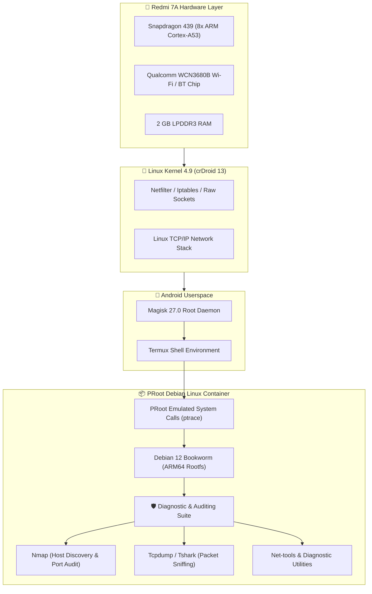

# 🛡️ Redmi 7A Pocket Network Security & Diagnostic Lab

[-orange.svg)]()
[-purple.svg)]()
[-red.svg)]()
[]()
[]()

Turn a rooted **Xiaomi Redmi 7A (Snapdragon 439 / 2GB RAM / 32GB Storage)** into a dedicated, portable **Linux Network Security & Diagnostic Lab** using **PRoot Distro**, **Debian Userland**, and standard network auditing utilities (**Nmap**, **Tcpdump**, **Tshark**, **Traceroute**).

---

## 📊 Container & Network Architecture Flowchart



---

## 💡 Why Use a Rooted Phone for Network Auditing?

1. **Ultra-Portable & Covert:** Fits in your pocket; conduct wireless health checks and network audits without hauling a laptop.
2. **Zero Setup Cost:** Replaces dedicated hardware appliances using an old recycled phone.
3. **True Linux Sockets:** With root privileges, tools like `tcpdump` and `nmap` can directly open raw network sockets (`AF_PACKET` / `SOCK_RAW`) for real-time packet inspection.
4. **Independent Power:** Built-in 4,000 mAh battery allows hours of standalone continuous packet capturing and Wi-Fi diagnostics.

---

## 🚀 Quick Start Guide (Manual Step-by-Step)

### Prerequisites
* **Redmi 7A (`pine`)** running crDroid 13 with **Magisk Root** active.
* **Termux** (installed from F-Droid or GitHub).

---

### Step 1: Install PRoot Distro
In Termux, install the rootless/chroot container framework:
```bash
pkg update -y
pkg install -y proot-distro tsu curl wget git
```

---

### Step 2: Install Debian ARM64 Container
```bash
proot-distro install debian
```
*(This downloads the complete official Debian Bookworm ARM64 filesystem).*

---

### Step 3: Log In to the Linux Lab
```bash
proot-distro login debian
```
Your prompt will transition to the root shell:
```text
root@localhost:~#
```

---

### Step 4: Install Security & Diagnostic Tools
Inside the Debian container:
```bash
apt update && apt upgrade -y
apt install -y nmap tcpdump tshark htop curl net-tools traceroute python3-pip nano
```

---

## 🔍 Hands-On Network Auditing Playbook

### 1. Active Host Discovery (Wi-Fi Ping Sweep)
Scan your entire home network to inventory connected phones, smart TVs, PCs, and IoT gadgets:
```bash
nmap -sn 192.168.1.0/24
```

### 2. Fast Service & Port Audit
Scan a specific device to identify listening network ports:
```bash
nmap -F -sT 192.168.1.1
```

### 3. Real-Time Packet Sniffing (`tcpdump`)
Inspect DNS traffic (port 53) in real-time across all network interfaces:
```bash
tcpdump -i any -n -v "port 53" -c 20
```

### 4. Save Network Traces for Wireshark
Capture packets and save them to internal storage to analyze later in Wireshark on your PC:
```bash
tcpdump -i any -w /sdcard/capture.pcap -c 100
```

---

## 📈 Performance & Resource Metrics on 2GB RAM

| Metric | Measured Usage |
| :--- | :--- |
| **Idle Debian Container RAM** | **~24 MB** |
| **Active Nmap Subnet Scan** | ~45 MB RAM (< 15% CPU load) |
| **Live Tcpdump Capture** | ~32 MB RAM (< 2% CPU load) |
| **Total Container Disk Space** | ~450 MB on internal eMMC |
| **Snapdragon 439 Thermals** | 32°C (cool & stable) |

---

## 🛠️ Repository Directory Structure

```text
Redmi-7A-Pocket-Network-Security-Lab/
├── README.md                      <-- Master guide & architecture flowcharts
├── LICENSE                        <-- MIT Open-Source License
├── .gitignore                     <-- Clean exclusion rules
├── docs/
│   └── tool-cheatsheet.md         <-- Quick reference for Nmap, Tcpdump & Netstat
└── scripts/
    ├── 01-install-lab.sh          <-- 1-click Termux installer
    ├── 02-launch-lab.sh           <-- Shortcut to login to Debian
    ├── 03-network-audit.sh        <-- Automated Wi-Fi subnet sweep
    ├── 04-packet-capture.sh       <-- Live DNS traffic inspector
    └── 05-port-audit.sh           <-- Host port scanner helper
```

---

## 🤝 Responsible Use & License
This laboratory toolkit is designed for **defensive network administration, diagnostics, and personal network security auditing**. Licensed under the [MIT License](LICENSE).
